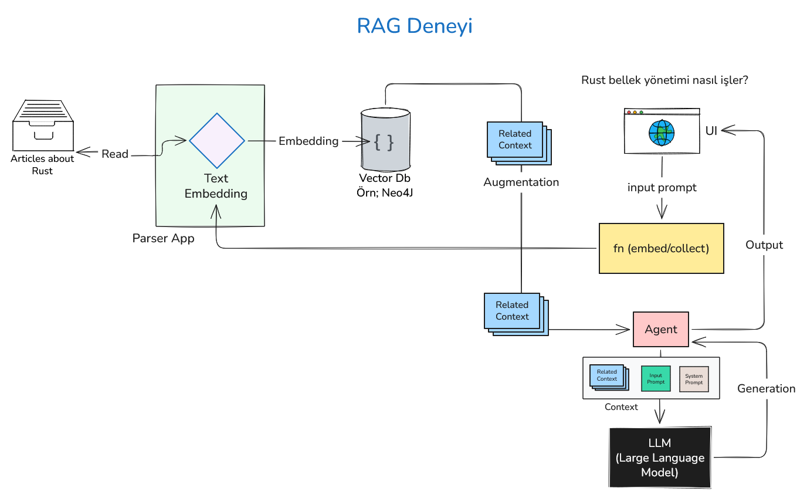
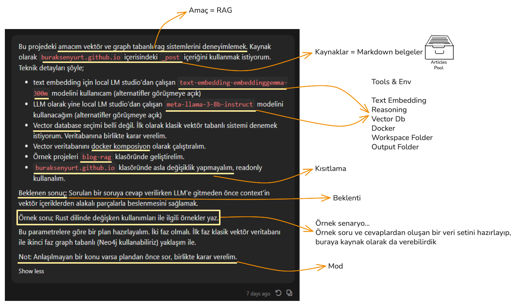

# RAG Deneme

Amaç, teknik makalelerden oluşan bir veri kaynağı üzerinden RAG kurgusunu oluşturmak. Kaynak
olarak [buraksenyurt.github.io](https://buraksenyurt.github.io) yazıları kullanılıyor ve iki
yaklaşım karşılaştırılıyor:

- **Faz 1:** Klasik vektör RAG (Qdrant)
- **Faz 2:** Graph tabanlı RAG (Neo4j)

Sonuçlar: [docs/FINDINGS.md](./docs/FINDINGS.md) · Plan ve kararlar: [PLAN.md](./PLAN.md) ·
Ajan kuralları: [AGENTS.md](./AGENTS.md)





## Gereksinimler

- Python 3.12 ve [uv](https://docs.astral.sh/uv/)
- Docker (Qdrant ve Neo4j için)
- [LM Studio](https://lmstudio.ai): `text-embedding-embeddinggemma-300m` ve bir sohbet modeli
  (ör. `gemma-3-4b-it-qat`). Context length en az 8192 olmalı.
- `buraksenyurt.github.io` reposu bu reponun yanında (`../buraksenyurt.github.io`). Kaynak
  repo **salt okunur** kullanılır.

## Uçtan uca çalıştırma (PowerShell)

```powershell
uv sync
Copy-Item .env.example .env
docker compose up -d qdrant neo4j
uv run python -m scripts.smoke_test                 # LM Studio / Qdrant / kaynak kontrolü

# Faz 1: chunk -> embedding (cache'li) -> Qdrant
uv run python -m scripts.build_chunks
uv run python -m phase1_vector.ingest
uv run python -m phase1_vector.ask "Rust dilinde değişken kullanımları ile ilgili örnekler yaz" --debug

# Faz 2: graph (vektörler cache'ten) -> graph retrieval + yapısal sorgular
uv run python -m phase2_graph.build_graph
uv run python -m phase2_graph.ask "Rust Pratikleri serisinde hangi yazılar var?" --debug

# İsteğe bağlı: LLM ile kavram çıkarımı pilotu (Rust yazıları, cache'li)
uv run python -m phase2_graph.extract_entities --limit 3 --dry-run

# Değerlendirme ve rapor
uv run python -m eval.run_eval --phase 1
uv run python -m eval.run_eval --phase 2
uv run python -m eval.report --out docs/results_tables.md
```

## Proje yapısı

```
common/          ayarlar, embedding/LLM istemcileri, chunk okuma, retrieval ve cevap akışı (ortak)
scripts/         smoke test, chunk üretimi
phase1_vector/   Qdrant ingest, retrieval, ask
phase2_graph/    Neo4j graph kurulumu, graph retrieval, yapısal sorgular, kavram çıkarımı, ask
eval/            soru seti, değerlendirme, rapor; sonuçlar eval/results/
docs/            bulgular, ölçüm tabloları, görseller
```
